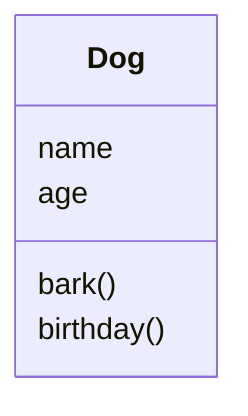

# Lesson 11: Classes and objects
As our programs get bigger, it gets harder to keep track of all our data. In [Lesson 5](../05-2d-lists), we stored students' names in one list and their scores in another. This works, but it's fragile: if we sort one list and forget to sort the other, or delete a name but not its scores, everything gets muddled up. It would be much nicer if each student's name and scores were bundled together into a single "thing".

_Object-oriented programming_ (OOP) lets us do exactly this. We can create our own types (called _classes_) that bundle together some data (called _attributes_) and some functions that work on that data (called _methods_).

You've actually been using objects all along! Every value in Python is an object. For example, `"hello"` is an object of the class `str`, and `.upper()` is one of its methods. `[1, 2, 3]` is an object of the class `list`, and `.append()` is one of its methods. In this lesson, we'll learn how to create our own classes.

## Defining a class
Here is a class representing a dog:
```python
class Dog:
    def __init__(self, name, age):
        self.name = name
        self.age = age

    def bark(self):
        print(f"{self.name} says: Woof!")

    def birthday(self):
        self.age = self.age + 1
        print(f"Happy birthday, {self.name}! You are now {self.age}.")
```

A class is like a _blueprint_: it describes what every dog has (a name and an age) and what every dog can do (bark and have a birthday). We can then use this blueprint to create as many individual dogs (called _objects_ or _instances_ of the class) as we like:
```python
rex = Dog("Rex", 3)
fido = Dog("Fido", 7)

rex.bark()          # prints "Rex says: Woof!"
fido.bark()         # prints "Fido says: Woof!"
rex.birthday()      # prints "Happy birthday, Rex! You are now 4."
print(fido.age)     # prints 7 (Fido's age hasn't changed)
```

Let's break this down:
1. `class Dog:` starts the class definition. By convention, class names use `CapitalisedWords` (sometimes called `PascalCase`), unlike variables and functions, which use `snake_case`.
2. Methods are defined inside the class, just like functions, using `def`.
3. `__init__` (with two underscores either side) is a special method, called the _constructor_. Python calls it automatically whenever you create a new object, e.g. `Dog("Rex", 3)`. Its job is to set up the new object's attributes.
4. Every method's first parameter is `self`. This is the object that the method is being called on. When you write `rex.bark()`, Python calls `bark` with `self` set to `rex`. You don't pass `self` in yourself: Python does it for you.
5. `self.name = name` creates an attribute called `name` on the object, and stores the value of the parameter `name` in it. Attributes belong to an individual object, so `rex.name` and `fido.name` are completely separate.

You can find this example in [`examples/dog.py`](examples/dog.py).

**Task 1:** Write a `Cat` class with attributes `name` and `colour`, and a method `meow` that prints something like `Tom the grey cat says: Meow!`. Create three cats and make each of them meow. [Solution](solutions/task1_cat.py)

**Task 2:** Write a `Rectangle` class with attributes `width` and `height`, and methods `area`, `perimeter` and `is_square`, which _return_ the area, the perimeter, and whether or not the rectangle is a square. Create a few rectangles and test each method. [Solution](solutions/task2_rectangle.py)

## Printing objects
What happens if we try to print a `Dog`?
```python
>>> print(rex)
<__main__.Dog object at 0x10b3e2d50>
```

That's not very helpful! We can tell Python how to turn our objects into strings by adding another special method, `__str__`, which should return a string:
```python
class Dog:
    ...

    def __str__(self):
        return f"{self.name} ({self.age} years old)"
```

Now `print(rex)` prints `Rex (4 years old)`, and we can use dogs in f-strings too: `f"My dog is {rex}"`.

> [!NOTE]
> Methods whose names start and end with two underscores are called _dunder methods_ (short for "double underscore") or _magic methods_. Python calls them automatically in certain situations: `__init__` when you create an object, `__str__` when you convert it to a string, and many more. You should almost never call them directly yourself.

**Task 3:** Write a `BankAccount` class. Each account should have an `owner` and a `balance`, which should start at 0 if no starting balance is given (hint: use a default parameter value, as in [Lesson 6](../06-functions)). Add the following methods: [Solution](solutions/task3_bank_account.py)
- `deposit(amount)`: adds `amount` to the balance.
- `withdraw(amount)`: takes `amount` away from the balance. If there isn't enough money in the account, it should raise a `ValueError` (see [Lesson 8](../08-exceptions)) instead.
- `__str__`: returns something like `Ada's account: £120.50`.

Test your class by creating an account, depositing and withdrawing some money, and trying to withdraw more money than is in the account (use `try`/`except` so your program doesn't crash).

## Objects in lists
Objects can be stored in lists, passed to functions, and returned from functions, just like any other value. This is where classes really start to pay off. Instead of keeping several lists in sync, we can keep a single list of objects:
```python
dogs = [Dog("Rex", 3), Dog("Fido", 7), Dog("Bella", 5)]

oldest = dogs[0]
for dog in dogs:
    if dog.age > oldest.age:
        oldest = dog

print(f"The oldest dog is {oldest}")
```

**Task 4:** Write a `Student` class. Each student should have a `name` and a list of `scores` (which should start empty). Add methods `add_score(score)` and `mean_score()`. Then use your class to redo [Lesson 5](../05-2d-lists) Task 3: create a list of `Student` objects with the data below, print each student's mean score, and print the name of the student with the highest mean score. [Solution](solutions/task4_students.py)
```python
names = ["Ada", "Alan", "Grace", "Tim"]
scores = [
    [72, 85, 64],  # Ada
    [90, 78, 88],  # Alan
    [65, 70, 71],  # Grace
    [81, 93, 77],  # Tim
]
```

> [!WARNING]
> Be careful with default values that are lists! If you write `def __init__(self, name, scores=[]):`, every student created without a `scores` argument will end up sharing _the same list_ (remember copying lists in [Lesson 4](../04-lists)?). Instead, don't make `scores` a parameter at all, and just write `self.scores = []` inside `__init__`.

## Class diagrams
When designing object-oriented programs, it's common to draw a _class diagram_ (part of a standard called UML, the Unified Modelling Language). Each class is drawn as a box with three sections: the class name at the top, then its attributes, then its methods. Here's a class diagram for our `Dog` class:


Different courses draw class diagrams in slightly different ways (e.g. some include the types of each attribute), so check how your course does it. We'll add some more detail to these diagrams in [Lesson 12](../12-inheritance-and-encapsulation).

> [!TIP]
> GitHub can draw diagrams like this from text, using a tool called [Mermaid](https://mermaid.js.org/syntax/classDiagram.html). Look at the source of this file to see how it's done!

**Task 5:** Draw a class diagram for your `BankAccount` class from Task 3. You can draw it on paper, or using Mermaid. [Solution](solutions/task5_class_diagram.md)

**Task 6:** Write a `Card` class representing a playing card, with a `rank` (e.g. `"A"`, `"7"` or `"K"`) and a `suit` (e.g. `"♠"`), and a `__str__` method that returns something like `7♠`. Then write a `Deck` class whose constructor creates a list of all 52 cards, with methods `shuffle()` (hint: look up `random.shuffle`), `deal()` (which removes the top card from the deck and returns it), and `__len__` (another dunder method, which Python calls when you use `len(deck)`). Deal yourself a hand of five cards, and print them along with how many cards are left in the deck. [Solution](solutions/task6_cards.py)

**⭐ Task 7:** Use your `Card` and `Deck` classes to write a game of "higher or lower". Deal a card and show it to the player, then deal a second card. Before showing it, ask the player whether it will be higher or lower than the first. Keep going until the player gets one wrong, then tell them their score. Hint: add a `value()` method to `Card` that returns a number for each rank (A = 1, J = 11, Q = 12, K = 13). You can decide what happens when two cards have the same value! [Solution](solutions/task7_higher_or_lower.py)

**⭐ Task 8:** Python lets you choose what operators like `+` and `==` do for your own classes, using more dunder methods. Write a `Vector` class representing a 2D vector, with attributes `x` and `y`. Add: [Solution](solutions/task8_vector.py)
- `__add__(self, other)`, which returns a new `Vector` that is the sum of `self` and `other`. Python calls this when you write `v1 + v2`.
- `__eq__(self, other)`, which returns `True` if both vectors have the same `x` and `y`. Python calls this when you write `v1 == v2`. (Try comparing two vectors with `==` _before_ you write this method. What happens, and why?)
- `__mul__(self, number)`, which multiplies the vector by a number (e.g. `v * 3`).
- `magnitude()`, which returns the length of the vector, $\sqrt{x^2 + y^2}$.
- `__str__`, which returns something like `(3, 4)`.

---
[← Previous: Lesson 10](../10-searching-and-sorting) | [Contents](../../README.md) | [Next: Lesson 12 →](../12-inheritance-and-encapsulation)
