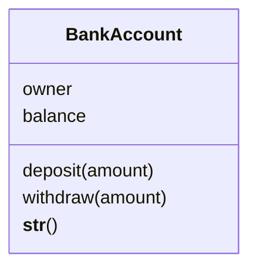

# Task 5 solution


The source for this diagram is:
```
classDiagram
    class BankAccount {
        owner
        balance
        deposit(amount)
        withdraw(amount)
        __str__()
    }
```

Some people leave out dunder methods like `__init__` and `__str__` from class diagrams, because every class has them. Some courses also expect you to include the types of attributes and parameters, e.g. `balance: float` and `deposit(amount: float)`.
