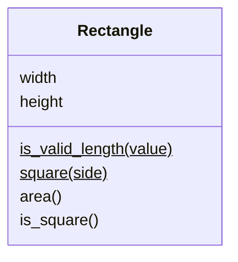

# Task 8 solution (class diagram)

The `$` after `is_valid_length` and `square` tells Mermaid that they're static, so it underlines them. (`square` is strictly a class method rather than a static method, but class diagrams don't distinguish between the two: both belong to the class rather than to an object.)
