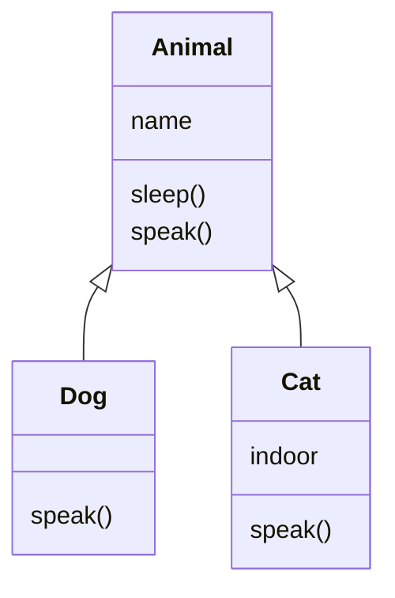
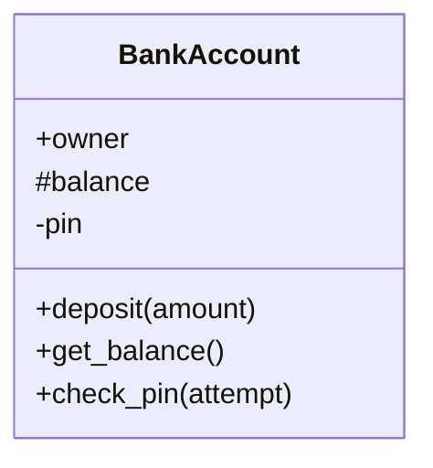

# Lesson 12: Inheritance and encapsulation
In [Lesson 11](../11-classes-and-objects), we learnt how to create our own classes. In this lesson, we'll look at two of the big ideas in object-oriented programming: _inheritance_, which lets us build new classes on top of existing ones, and _encapsulation_, which is about hiding the inner workings of a class from the code that uses it. Along the way, we'll take a short detour into another language, C++, to see how encapsulation works there, and why Python does things differently.

## Inheritance
Often, several classes have a lot in common. Dogs and cats are both animals: they both have a name, they can both eat and sleep, and they can both make a noise (although a different one). Rather than writing the same code in a `Dog` class and a `Cat` class, we can put the shared code in an `Animal` class, and have `Dog` and `Cat` _inherit_ from it:
```python
class Animal:
    def __init__(self, name):
        self.name = name

    def sleep(self):
        print(f"{self.name} is sleeping. Zzz...")

    def speak(self):
        print(f"{self.name} makes a noise.")


class Dog(Animal):
    def speak(self):
        print(f"{self.name} says: Woof!")


class Cat(Animal):
    def __init__(self, name, indoor):
        super().__init__(name)
        self.indoor = indoor

    def speak(self):
        print(f"{self.name} says: Meow!")
```

`class Dog(Animal):` means that `Dog` inherits from `Animal`. We say that `Animal` is the _parent class_ (or _superclass_, or _base class_), and `Dog` is the _child class_ (or _subclass_, or _derived class_). A `Dog` automatically gets everything an `Animal` has, so we can call `rex.sleep()` even though we never wrote a `sleep` method in `Dog`.

There are a few more things to notice:
1. **Overriding:** both `Dog` and `Cat` define their own `speak` method, which replaces (or _overrides_) the one in `Animal`. When we call `rex.speak()`, Python looks for a `speak` method in `Dog` first. It only looks in `Animal` if it can't find one.
2. **`super()`:** `Cat` needs an extra attribute, `indoor`, so it has its own `__init__`. But we still want `Animal.__init__` to set up the name. `super().__init__(name)` calls the parent class's version of `__init__`. You can use `super()` to call the parent's version of any method, not just `__init__`.
3. **"Is a":** inheritance describes an "is a" relationship: a dog _is an_ animal. You can check this using `isinstance`: `isinstance(rex, Animal)` is `True`. If the relationship is "has a" (e.g. a car _has an_ engine), you should store an object as an attribute instead of using inheritance. This is called _composition_ (or _aggregation_).

One of the most powerful things about inheritance is that we can treat objects of different classes in the same way, as long as they share a parent class. This is called _polymorphism_ (from the Greek for "many forms"):
```python
animals = [Dog("Rex"), Cat("Tom", indoor=True), Dog("Fido")]
for animal in animals:
    animal.speak()  # each animal uses its own version of `speak`
```

You can find this example in [`examples/animals.py`](examples/animals.py).

We can show inheritance on a class diagram using an arrow with a hollow triangle, pointing from the child class to the parent class:


**Task 1:** Write a `Shape` class with a `name` attribute, an `area` method that returns `0`, and a `describe` method that prints something like `A circle with area 12.57`. Then write subclasses `Rectangle` (with a `width` and a `height`), `Circle` (with a `radius`) and `Square`, each of which overrides `area`. `Square` should inherit from `Rectangle`, and should only need a single `side` argument (hint: use `super().__init__`). Create a list containing a few different shapes, and call `describe` on each of them. [Solution](solutions/task1_shapes.py)

**Task 2:** Write an `Employee` class with a `name` and an annual `salary`, and a method `monthly_pay()` that returns one twelfth of their salary. Then write a `Manager` subclass with an extra `annual_bonus` attribute, whose `monthly_pay()` also includes one twelfth of their bonus. Use `super()` so that you don't repeat the salary calculation. [Solution](solutions/task2_employees.py)

## Encapsulation
When you use a list, you don't need to know how Python stores it in memory. You just use its methods: `.append`, `.sort`, and so on. This is _encapsulation_: an object bundles its data together with the methods that work on that data, and hides the details of how it works from the code that uses it. This has two big advantages:
1. **Protecting the data:** if other code can only change an object's data using its methods, then the methods can check that every change makes sense. For example, a `BankAccount` can make sure that nobody deposits a negative amount of money.
2. **Freedom to change:** if other code only uses an object's methods, the inner workings of the class can be changed later without breaking any of the code that uses it.

To make this work, many programming languages let you control who can access each attribute and method, using _access modifiers_. Python is a bit unusual here, so let's first look at how a language like C++ (or Java, or C#) does it.

### Access modifiers in C++
C++ has three access modifiers:
- **`public`:** anyone can access it.
- **`protected`:** only the class itself and its subclasses can access it.
- **`private`:** only the class itself can access it.

Here's a cut-down version of [`examples/bank_account.cpp`](examples/bank_account.cpp). Don't worry if the C++ syntax looks unfamiliar: focus on the `public:`, `protected:` and `private:` sections.
```cpp
class BankAccount {
public:
    // Public: anyone can use these
    std::string owner;
    void deposit(double amount) { ... }
    double get_balance() const { return balance; }

protected:
    // Protected: only this class and its subclasses can use these
    double balance;

private:
    // Private: only this class can use these
    int pin;
};

class SavingsAccount : public BankAccount {
public:
    void add_interest() {
        balance += balance * interest_rate;  // fine: `balance` is protected
        // pin = 0;                          // error: `pin` is private to BankAccount
    }
    ...
};

int main() {
    SavingsAccount account("Ada", 100.0, 1234, 0.05);
    account.deposit(50.0);
    account.add_interest();

    // account.balance = 1000000.0;  // error: `balance` is protected
    // std::cout << account.pin;     // error: `pin` is private
}
```

Notice that `balance` is protected, so code outside the class can't change it directly. Instead, it has to use the public `deposit` method (which checks that the amount is positive), and the public `get_balance` method to read it. A method like `get_balance`, whose only job is to give you the value of a hidden attribute, is called a _getter_ (or _accessor_). A method whose job is to change a hidden attribute is called a _setter_ (or _mutator_).

The crucial point is that the C++ _compiler_ enforces these rules. If you uncomment the line `account.balance = 1000000.0;` and try to compile the program, the compiler refuses:
```
bank_account.cpp:59:13: error: 'balance' is a protected member of 'BankAccount'
   59 |     account.balance = 1000000.0;  // error: `balance` is protected
      |             ^
bank_account.cpp:30:12: note: declared protected here
   30 |     double balance;
      |            ^
1 error generated.
```

#### Compiling and running the C++ example
Unlike Python, C++ is a _compiled_ language: before you can run a C++ program, a _compiler_ has to translate it into machine code that your computer can run directly. If you'd like to try this yourself, you first need to install a compiler:
- **macOS:** run `xcode-select --install` in the terminal. This installs Apple's command line tools, which include a C++ compiler called `clang` (which you can run using the command `g++`).
- **Debian-based Linux:** run `sudo apt install g++` in the terminal.
- **Windows:** the easiest option is to install [MSYS2](https://www.msys2.org/), then run `pacman -S mingw-w64-ucrt-x86_64-gcc` in the "MSYS2 UCRT64" terminal, and add `C:\msys64\ucrt64\bin` to your `PATH` (VS Code has [a guide to this](https://code.visualstudio.com/docs/cpp/config-mingw)). If you'd rather not install anything, you can use an online compiler like [Compiler Explorer](https://godbolt.org/) or [OnlineGDB](https://www.onlinegdb.com/online_c++_compiler) instead.

Then, in the folder containing `bank_account.cpp`, compile the program with:
```sh
g++ -std=c++17 -Wall bank_account.cpp -o bank_account
```

This creates a new file called `bank_account` (or `bank_account.exe` on Windows), which you can run with `./bank_account` (or `.\bank_account.exe` on Windows). (`-std=c++17` tells the compiler which version of C++ to use, `-Wall` asks it to warn you about anything suspicious, and `-o bank_account` sets the name of the output file.)

### Access modifiers in Python
Python doesn't have access modifiers. _Every_ attribute and method can be accessed from anywhere. Instead, Python programmers rely on naming conventions:
- **`name`:** a normal name means the attribute is public.
- **`_name`:** a single leading underscore means "this is internal: please don't use it from outside the class (or its subclasses)". This is roughly equivalent to `protected`. Python doesn't enforce it _at all_: it's just a polite request to other programmers. (VS Code will warn you if you break it, though.)
- **`__name`:** two leading underscores (and no more than one trailing underscore) trigger _name mangling_: inside the class `BankAccount`, Python quietly renames `__name` to `_BankAccount__name`. This means `account.__pin` gives an `AttributeError` from outside the class, and stops subclasses from accidentally overwriting the attribute. It's the closest thing Python has to `private`, but it's not truly private: you can still access `account._BankAccount__pin` if you really want to.

Here's the same bank account in Python ([`examples/bank_account.py`](examples/bank_account.py)):
```python
class BankAccount:
    def __init__(self, owner, balance, pin):
        self.owner = owner       # public
        self._balance = balance  # "protected" (by convention only!)
        self.__pin = pin         # "private" (name mangled, but still accessible)
    ...

account = SavingsAccount("Ada", 100.0, 1234, 0.05)

# None of these cause an error in Python!
account._balance = 1_000_000.0
print(f"The PIN is {account._BankAccount__pin}")
```

Why doesn't Python enforce these rules? It's a deliberate choice. Python's philosophy is often summed up as "we're all consenting adults here": rather than stopping you from doing something, Python trusts you to respect the conventions, and to take responsibility if you break them. In practice, single underscores are used all the time, and double underscores are used much less often (mostly to avoid name clashes in subclasses).

> [!NOTE]
> Even in C++, access modifiers aren't really a _security_ feature: a determined programmer can still get at private data. They're there to stop people (including you!) from using a class in ways it wasn't designed for, by accident. Python's conventions do the same job, but rely on programmers to follow them, rather than on the compiler to enforce them.

We can show access modifiers on a class diagram using `+` for public, `#` for protected, and `-` for private:


**Task 3:** Predict what each `print` statement in [`examples/name_mangling.py`](examples/name_mangling.py) will do, then run it to check. [Solution](solutions/task3_name_mangling.md)

**Task 4:** Compile and run [`examples/bank_account.cpp`](examples/bank_account.cpp) (see the instructions above). Then uncomment each of the three lines marked `error`, one at a time, and try to compile it again. Read each error message carefully. Which line causes which error, and why? [Solution](solutions/task4_cpp_access_errors.md)

## Properties
In languages like C++ and Java, it's common to make _every_ attribute private, and write getters and setters for them all (`get_balance()`, `set_balance()`, and so on). In Python, this is considered unnecessary: if an attribute doesn't need any special treatment, just make it public. If you later decide that it _does_ need special treatment (e.g. you want to check that it's never set to a negative number), you can turn it into a _property_. A property looks like a normal attribute from the outside, but behind the scenes, Python calls a method whenever it is read or changed:
```python
class Person:
    def __init__(self, name, age):
        self.name = name
        self.age = age  # this calls the setter below!

    @property
    def age(self):
        """The getter: called when you read `person.age`"""
        return self._age

    @age.setter
    def age(self, value):
        """The setter: called when you write `person.age = value`"""
        if value < 0:
            raise ValueError("Age can't be negative")
        self._age = value


ada = Person("Ada", 36)
print(ada.age)  # calls the getter, prints 36
ada.age = 37    # calls the setter
ada.age = -5    # calls the setter, which raises a ValueError
```

The `@property` and `@age.setter` lines are called _decorators_. Don't worry about exactly how they work: just remember that `@property` goes above the getter, and `@<name>.setter` goes above the setter. If you leave out the setter, the property becomes _read-only_: trying to change it gives an `AttributeError`.

You can find this example in [`examples/properties.py`](examples/properties.py).

**Task 5:** Rewrite your `BankAccount` class from [Lesson 11](../11-classes-and-objects) Task 3 so that the balance is stored in a "protected" attribute `_balance`. Add a read-only `balance` property, so that other code can read the balance, but can only change it using `deposit` and `withdraw`. Both of these should raise a `ValueError` if the amount isn't positive. Check that `account.balance = 1000000` now raises an `AttributeError`. [Solution](solutions/task5_bank_account.py)

**Task 6:** Write a `Temperature` class that stores a temperature in degrees Celsius. Give it a `celsius` property whose setter raises a `ValueError` if the temperature is below absolute zero (−273.15 °C), and a `fahrenheit` property with a getter _and_ a setter, which converts to and from Celsius. You should be able to write code like: [Solution](solutions/task6_temperature.py)
```python
t = Temperature(100)
print(t.fahrenheit)  # 212.0
t.fahrenheit = 32
print(t.celsius)     # 0.0
t.celsius = -300     # ValueError
```

**Task 7:** Draw a class diagram for the C++ `BankAccount` and `SavingsAccount` classes in [`examples/bank_account.cpp`](examples/bank_account.cpp), showing the inheritance relationship and the access modifier of every attribute and method. [Solution](solutions/task7_class_diagram.md)

**⭐ Task 8:** Write a C++ version of the `Rectangle` class from [Lesson 11](../11-classes-and-objects) Task 2. Its `width` and `height` should be private, with public getters and setters. The setters should refuse to set a width or height that isn't positive (in C++, you can do this by printing a message and returning early, as in `deposit`). Add public `area` and `perimeter` methods, and write a `main` function that tests your class. Use [`examples/bank_account.cpp`](examples/bank_account.cpp) as a guide to the syntax. [Solution](solutions/task8_rectangle.cpp)

**⭐ Task 9:** In Task 1, `Shape.area()` returns `0`, which doesn't really make sense: a generic "shape" doesn't have an area! It would be better if it wasn't possible to create a plain `Shape` at all, only specific shapes like `Circle` and `Rectangle`. A class like this is called an _abstract class_. Look up Python's [`abc` module](https://docs.python.org/3/library/abc.html), and use `ABC` and `@abstractmethod` to make `Shape` abstract. What happens when you try to create a `Shape`? What happens if you create a subclass that forgets to define `area`? [Solution](solutions/task9_abstract_shapes.py)

---
[← Previous: Lesson 11](../11-classes-and-objects) | [Contents](../../README.md)
