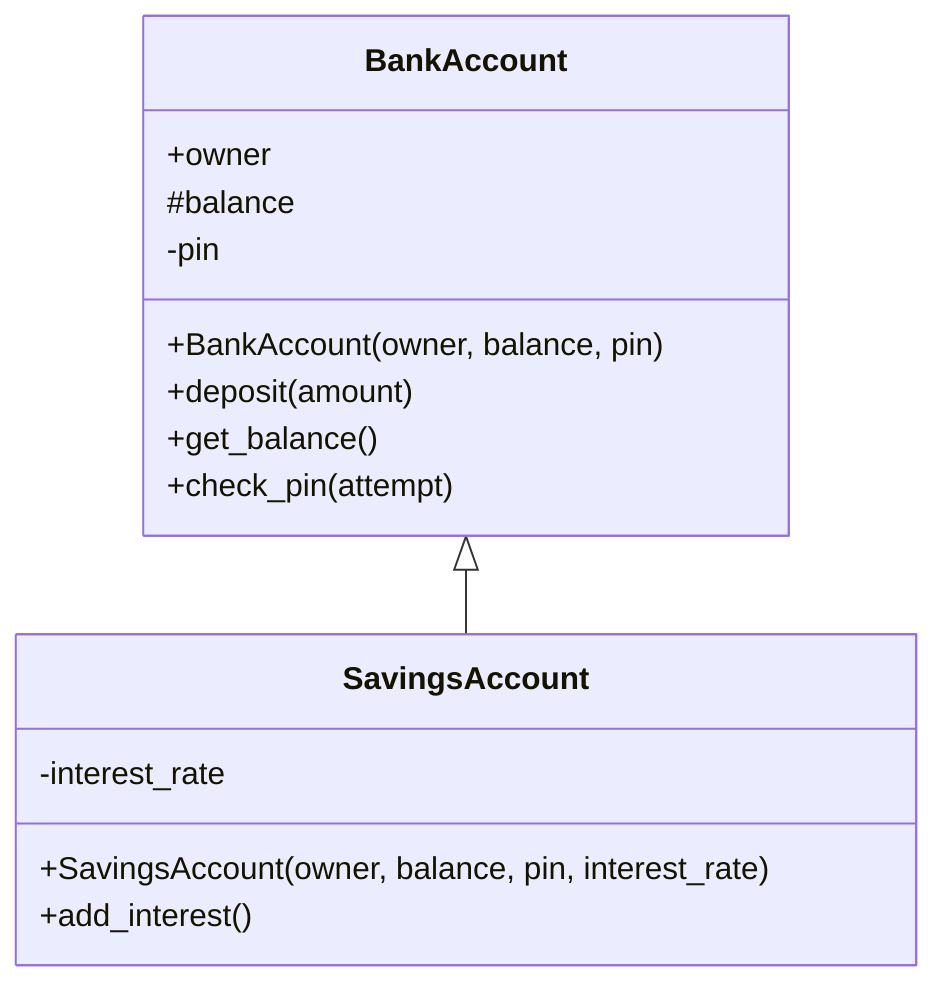

# Task 7 solution

Notice that `SavingsAccount` doesn't list `owner`, `balance`, `deposit` and so on again: it inherits them from `BankAccount`, and the arrow shows this. In C++, the constructor has the same name as the class, which is why `BankAccount(owner, balance, pin)` appears as a method. Some courses also expect you to include the types, e.g. `#balance: double` and `+get_balance(): double`.
