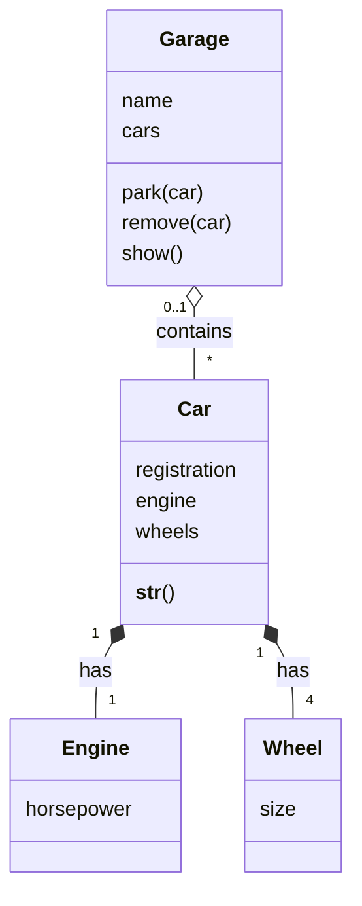

# Task 8 solution (class diagram)

- `Car` and `Engine`, and `Car` and `Wheel`, are joined by **composition** (filled diamonds), because the car creates its engine and wheels, and they don't exist on their own. Each car has exactly 1 engine and exactly 4 wheels.
- `Garage` and `Car` are joined by **aggregation** (a hollow diamond), because cars exist independently of garages and can move between them. A garage can hold any number of cars (`*`), and a car is in at most one garage at a time (`0..1`).
