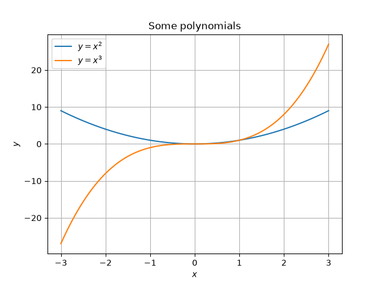

# Lesson 14: Modules and third-party packages
One of the best things about Python is that you rarely have to write everything yourself. Python comes with a huge _standard library_ of ready-made code, and there are hundreds of thousands of _third-party packages_ written by other people that you can download for free. In this lesson, we'll learn how to use other people's code (and how to organise our own), then try out two of the most popular packages: `numpy`, for working with numbers, and `matplotlib`, for drawing graphs.

## Modules
A _module_ is just a Python file containing code (usually functions and classes) that other programs can use. We've been using modules since [Lesson 1](../01-variables-and-types), when we wrote `import math`. There are several ways to import things from a module:
```python
import math                  # import the whole module...
print(math.sqrt(16))         # ...then use `math.` in front of everything

from math import sqrt, pi    # import specific things from a module...
print(sqrt(16) * pi)         # ...then use them without `math.`

import statistics as stats   # import a module under a shorter name
print(stats.median([3, 1, 4, 1, 5]))
```

The first way is usually the clearest, because it's obvious where each function comes from. The third way is very common for packages with long names, or that are used a lot: for example, everyone writes `import numpy as np`.

Here are some of the most useful modules in the standard library. You don't need to install anything to use these: they come with Python.

| Module        | What it's for                                            | Example                                   |
|---------------|----------------------------------------------------------|-------------------------------------------|
| `math`        | Maths functions and constants                            | `math.sqrt(2)`, `math.pi`                 |
| `random`      | Random numbers and choices                               | `random.randint(1, 6)`                    |
| `statistics`  | Mean, median, mode, standard deviation, etc.             | `statistics.median([3, 1, 4])`            |
| `datetime`    | Dates and times                                          | `datetime.date.today()`                   |
| `time`        | Timing code, and pausing your program                    | `time.sleep(1)`                           |
| `csv`         | Reading and writing CSV files                            | `csv.reader(file)`                        |
| `json`        | Reading and writing JSON files                           | `json.load(file)`                         |
| `collections` | Extra collection types                                   | `collections.Counter("banana")`           |

The full list is in the [Python documentation](https://docs.python.org/3/library/index.html). It's worth having a browse!

## Writing your own modules
Any Python file can be used as a module. For example, if you save some functions in a file called `geometry.py`, you can use them in another program in the same folder by writing `import geometry`. This is a great way to organise bigger programs, and to re-use code between programs.

There's one thing to watch out for. When you import a module, Python _runs_ the whole file. So if `geometry.py` contains some code to test its functions, that code will run every time you import it! To stop this from happening, put any code that should only run when you run the file directly inside an `if __name__ == "__main__":` block:
```python
# geometry.py
import math

def circle_area(radius):
    return math.pi * radius**2

if __name__ == "__main__":
    # This only runs if you run `python geometry.py`, not when you import it
    print(circle_area(1))
```

When Python runs a file directly, it sets the special variable `__name__` to `"__main__"`. When it imports a file as a module, it sets `__name__` to the name of the module (here, `"geometry"`) instead. You can find this example in [`examples/geometry.py`](examples/geometry.py) and [`examples/use_geometry.py`](examples/use_geometry.py).

**Task 1:** Create a module called `shapes.py` containing your `sphere_surface_area` and `octahedron_surface_area` functions (from [Lesson 6](../06-functions)), and a test block that only runs when you run `shapes.py` directly. Then write a separate program that imports your module and uses it to print a table of surface areas for spheres and octahedra of sizes 1 to 5 cm. [Solution (module)](solutions/shapes.py) | [Solution (program)](solutions/task1_use_shapes.py)

**Task 2:** Use the `datetime` module to write a program that asks the user for their birthday (month and day), and tells them how many days it is until their next birthday. Hint: you can create a date using `datetime.date(year, month, day)`, and subtracting one date from another gives you a `timedelta` object, which has a `.days` attribute. [Solution](solutions/task2_birthday.py)

## Third-party packages
_Packages_ are collections of modules that other people have written and shared. Most of them are published on the [Python Package Index (PyPI)](https://pypi.org/), and can be installed with a single command. Unlike the standard library, these don't come with Python, so you need to install them before you can use them.

### Virtual environments
Before we install anything, we need to talk about _virtual environments_. If you install packages directly into your main Python installation, all of your projects end up sharing the same packages. Sooner or later, two projects will need different versions of the same package, and everything breaks. (In fact, on macOS and Linux, Python will often refuse to let you install packages this way, with an `externally-managed-environment` error.)

The solution is to give each project its own _virtual environment_: a folder (usually called `.venv`) containing a private copy of Python and that project's packages. Each project can then install whatever it needs without affecting anything else.

There are several ways of creating virtual environments and installing packages. We'll look at three of them. You only _need_ one, but it's worth knowing about all of them, as you'll come across all of them in the real world.

### Option 1: `venv` and `pip`
`venv` (for creating virtual environments) and `pip` (for installing packages) come with Python, so you don't need to install anything else. In your project folder, run:
```sh
python -m venv .venv
```

This creates a virtual environment in a folder called `.venv`. Next, you need to _activate_ it, which tells your terminal to use the Python inside `.venv` instead of your main installation:
- **macOS / Linux:** `source .venv/bin/activate`
- **Windows (PowerShell):** `.venv\Scripts\Activate.ps1`

You should now see `(.venv)` at the start of your terminal prompt. You'll need to activate the environment again every time you open a new terminal (although VS Code will usually do this for you). You can now install packages with `pip`, and run your code as normal:
```sh
pip install numpy matplotlib
python my_program.py
```

> [!TIP]
> On Windows, if PowerShell refuses to run `Activate.ps1`, run `Set-ExecutionPolicy -Scope CurrentUser RemoteSigned` once, then try again.

### Option 2: `uv pip`
If you installed [`uv`](https://docs.astral.sh/uv/) in [Lesson 0](../00-getting-started), you can do exactly the same thing, but much faster. `uv` has its own version of `pip`, which works in the same way:
```sh
uv venv
uv pip install numpy matplotlib
```

`uv venv` creates a virtual environment in `.venv`, and `uv pip install` installs packages into it. You don't even need to activate the environment first: `uv` finds it automatically. To run your code using the virtual environment, either activate it (as above) and use `python`, or use `uv run`:
```sh
uv run my_program.py
```

### Option 3: `uv` projects
Options 1 and 2 have a problem: if you share your code with someone else (or move to a new computer), how do they know which packages to install? `uv` can keep track of this for you. In your project folder, run:
```sh
uv init
uv add numpy matplotlib
```

`uv init` sets up your folder as a _project_, and creates a file called `pyproject.toml`. `uv add` installs packages, and also records them in `pyproject.toml` (along with the exact versions that were installed, in a file called `uv.lock`). Anyone who has a copy of your project can then run `uv run my_program.py`, and `uv` will automatically install exactly the right packages before running it. This is how most new Python projects are set up nowadays.

### Using this repository
This repository is itself a `uv` project. `numpy` and `matplotlib` are listed in [`pyproject.toml`](../../pyproject.toml) as a _dependency group_ called `scientific`. Dependency groups are sets of packages that aren't installed by default, so that you only download them when you need them (none of the other lessons need them!). If you've downloaded this repository, you can install them with:
```sh
uv sync --group scientific
```

and run programs that need them with:
```sh
uv run --group scientific python examples/numpy_basics.py
```

> [!NOTE]
> Don't forget the `--group scientific`! Without it, `uv run` won't install `numpy` and `matplotlib` for you, so you'll get a `ModuleNotFoundError` if they aren't already installed. Also, running `uv sync` _without_ `--group scientific` makes your environment match the default dependencies exactly, which means it will uninstall them again.

**Task 3:** Create a new folder for this lesson, set up a virtual environment in it using _one_ of the options above, and install `numpy` and `matplotlib`. Check that it worked by running `python -c "import numpy; print(numpy.__version__)"` (or `uv run python -c ...`). If you have time, try one of the other options too. [Solution](solutions/task3_installing_packages.md)

## numpy
`numpy` (short for "numerical Python") is the most widely used package for working with numbers in Python. It's used in almost every area of science and engineering. Its main feature is the _array_: a grid of numbers (a bit like a list or a 2D list) that you can do maths on all at once:
```python
import numpy as np

heights = np.array([1.62, 1.75, 1.58, 1.81])  # in metres
heights_cm = heights * 100                     # multiplies EVERY item by 100
print(heights_cm)                              # [162. 175. 158. 181.]
print(heights.mean(), heights.max())           # 1.69 1.81
```

Compare this with a normal list, where `[1, 2, 3] * 2` gives `[1, 2, 3, 1, 2, 3]`! Doing maths on whole arrays at once (called _vectorisation_) means we don't need to write loops, and it's also _much_ faster, because numpy is written in C.

Some other useful features:
```python
np.arange(0, 10, 2)       # like `range`, but gives an array: [0 2 4 6 8]
np.linspace(0, 1, 5)      # 5 evenly spaced numbers from 0 to 1: [0. 0.25 0.5 0.75 1.]
np.sqrt(heights)          # numpy has its own maths functions that work on arrays
heights > 1.7             # gives an array of True/False values: [False True False True]
heights[heights > 1.7]    # picks out only the values where the condition is True
(heights > 1.7).sum()     # counts how many values are True (True counts as 1)
```

Arrays can also be 2D (or 3D, or more!). `grid.shape` tells you the number of rows and columns, and you can pick out items using `grid[row, column]`:
```python
grid = np.array([[1, 2, 3], [4, 5, 6]])
print(grid.shape)        # (2, 3)
print(grid[1, 2])        # 6
print(grid[:, 1])        # the middle column: [2 5]
print(grid.sum(axis=0))  # the sum of each column: [5 7 9]
```

You can find these examples in [`examples/numpy_basics.py`](examples/numpy_basics.py).

**Task 4:** Using the temperatures from [Lesson 4](../04-lists) Task 3 (below), use numpy (and no loops!) to: [Solution](solutions/task4_numpy_temperatures.py)
1. Find the mean, highest and lowest temperatures.
2. Convert all the temperatures to Fahrenheit.
3. Count how many days were warmer than 20 °C.
4. Print the temperatures that were above the mean.

```python
temperatures = [18.2, 21.5, 19.8, 23.1, 25.4, 22.0, 17.6]
```

## matplotlib
`matplotlib` is the most popular package for drawing graphs in Python. Most of the time, we use its `pyplot` module, which everyone imports as `plt`:
```python
import matplotlib.pyplot as plt
import numpy as np

x = np.linspace(-3, 3, 100)

plt.plot(x, x**2, label="$y = x^2$")
plt.plot(x, x**3, label="$y = x^3$")
plt.xlabel("$x$")
plt.ylabel("$y$")
plt.title("Some polynomials")
plt.legend()
plt.grid()
plt.savefig("polynomials.png")  # saves the graph as an image
plt.show()                      # opens a window showing the graph
```

This draws the graph below. `plt.plot(x, y)` draws a line through the points `(x[0], y[0])`, `(x[1], y[1])`, and so on, so the more points you use, the smoother the line looks. Notice that we can use `$...$` to write maths in labels.



Some other useful types of plot are:
- `plt.scatter(x, y)`: draws a dot at each point, without joining them up.
- `plt.bar(labels, heights)`: draws a bar chart.
- `plt.hist(data, bins=10)`: draws a histogram of some data.

You can find this example in [`examples/plotting.py`](examples/plotting.py). The [matplotlib gallery](https://matplotlib.org/stable/gallery/index.html) has hundreds more examples, along with the code used to make them.

> [!TIP]
> `plt.show()` pauses your program until you close the graph's window. If you want to save the graph as well as showing it, call `plt.savefig` _before_ `plt.show`, otherwise you'll save an empty image!

**Task 5:** Plot $y = \sin x$ and $y = \cos x$ on the same axes, for $x$ between $0$ and $2\pi$. Label your axes, add a title and a legend, and save your graph as `trig.png`. Hint: numpy has `np.sin`, `np.cos` and `np.pi`. [Solution](solutions/task5_trig.py) | [Graph](images/trig.png)

**Task 6:** Use [`weather.csv`](data/weather.csv) from [Lesson 9](../09-files) to plot the maximum and minimum temperature on each day, on the same axes. Hint: `np.loadtxt("weather.csv", delimiter=",", skiprows=1, usecols=(1, 2))` loads the numbers from the second and third columns into a 2D array, skipping the header. Can you work out how to show the date on the $x$-axis? [Solution](solutions/task6_weather.py) | [Graph](images/weather.png)

**Task 7:** In [Lesson 6](../06-functions) Task 9, we simulated rolling two dice 10,000 times and drew a bar chart using `#` symbols. Do it again using numpy and matplotlib. Hint: `rng = np.random.default_rng()` creates a random number generator, and `rng.integers(1, 7, size=10_000)` gives you an array of 10,000 dice rolls. (Unlike `random.randint`, the second number is _not_ included, just like `range`.) [Solution](solutions/task7_dice.py) | [Graph](images/dice.png)

**⭐ Task 8:** You can estimate $\pi$ by throwing darts! Imagine a circle of radius 1 inside a square with sides of length 2. If you throw lots of darts at random points in the square, the fraction that land inside the circle should be roughly $\frac{\text{area of circle}}{\text{area of square}} = \frac{\pi}{4}$. Use numpy to "throw" 10,000 random darts (with $x$ and $y$ coordinates between $-1$ and $1$), estimate $\pi$, and draw a scatter plot showing the darts that landed inside the circle in one colour and those outside it in another. Hint: `rng.uniform(-1, 1, size=10_000)`. [Solution](solutions/task8_monte_carlo_pi.py) | [Graph](images/monte_carlo_pi.png)

**⭐ Task 9:** Use your bubble sort and merge sort functions from [Lesson 10](../10-searching-and-sorting) to plot how long each algorithm takes to sort random lists of 100, 200, 300, ..., 2000 numbers. Plot both on the same axes. Does the shape of each line match what you'd expect from the table in Lesson 10? [Solution](solutions/task9_sorting_times.py) | [Graph](images/sorting_times.png)

---
[← Previous: Lesson 13](../13-dictionaries-and-sets) | [Contents](../../README.md) | [Next: Lesson 15 →](../15-type-hints-and-dataclasses)
